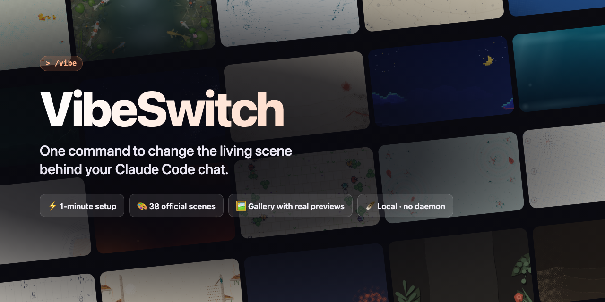
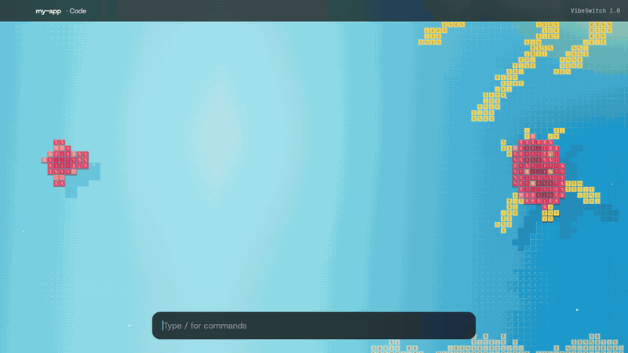
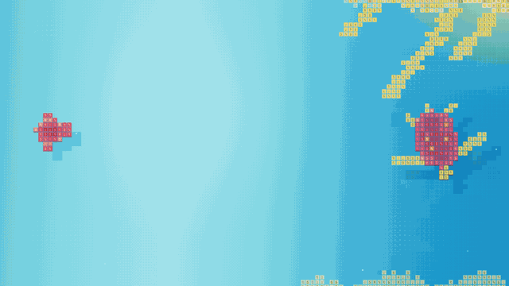
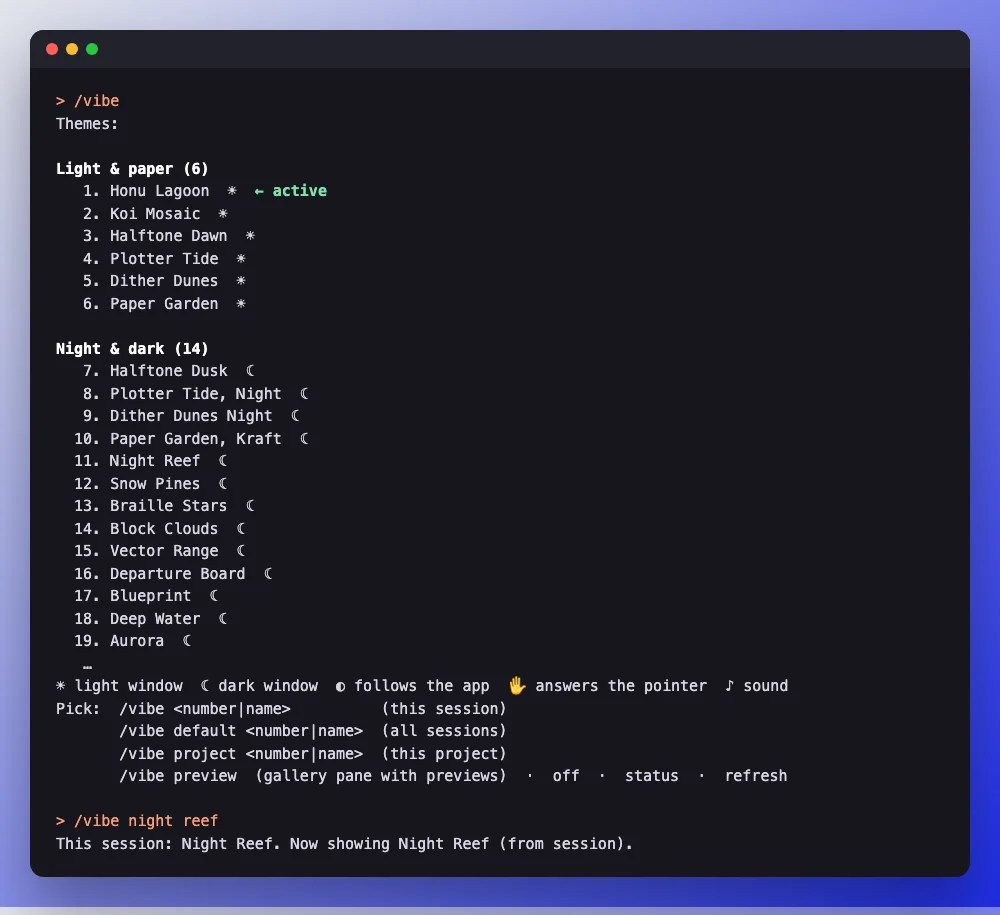
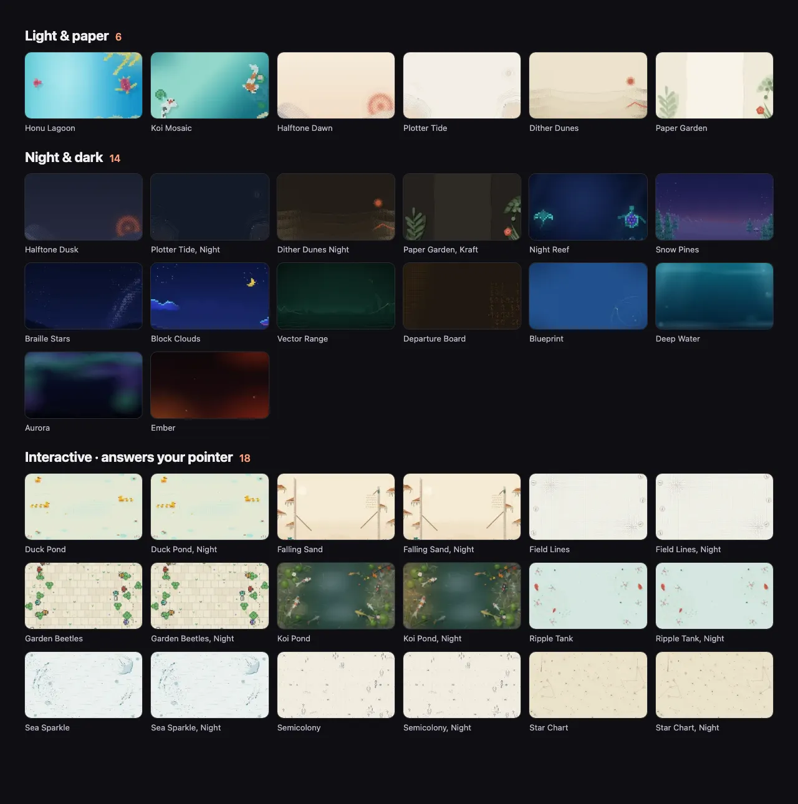
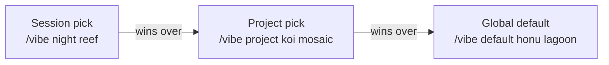

<p align="center">
  
</p>

<p align="center">
  <b>Type <code>/vibe</code>. Your Claude Code window gets a new living scene.</b><br>
  38 official animated scenes · a gallery with real previews · default, per-project and per-session picks · all local<br>
  Works in <b>Claude Desktop</b> (scenes + gallery) and the <b>Claude Code CLI</b> (list, switch, save picks)
</p>

<p align="center">
  <a href="#-install-in-about-a-minute"></a>
  <a href="https://github.com/anthropics/claude-plugins-official/tree/main/plugins/theme-examples"></a>
  <a href="LICENSE"></a>
  <a href="https://github.com/ruihaomei/vibeswitch/stargazers"></a>
</p>

<p align="center"><a href="https://ruihaomei.github.io/vibeswitch/">Website</a> · <a href="README.zh-CN.md">简体中文</a> · <a href="AGENTS.md">Guide for AI agents</a> · <a href="https://buildwithclaude.com/themes">More themes</a></p>

<p align="center"><br><sub>12-second demo · <a href="https://ruihaomei.github.io/vibeswitch/#demo">watch it with sound</a></sub></p>

---

## ⚡ Install in about a minute

**Easiest: let your agent do it.** Paste this one line into Claude Code (or any coding agent on your Mac):

```text
Install the VibeSwitch plugin for Claude Code by following https://github.com/ruihaomei/vibeswitch/blob/main/AGENTS.md, then tell me how to start using it.
```

**Or run two commands yourself:**

```bash
claude plugin install theme-examples --marketplace anthropics/claude-plugins-official
```

```bash
claude plugin install vibeswitch --marketplace ruihaomei/vibeswitch
```

The first installs Anthropic's official scenes; the second installs VibeSwitch. Answer `y` if asked to add a marketplace.

**Then:**

1. Open the **Claude desktop app → Code tab** and start a **new session**.
2. Type **`/vibe`** and pick a number. Done.

<p align="center"></p>

## Why VibeSwitch

| | |
|---|---|
| 🎯 **One command** | `/vibe` lists every scene you have; `/vibe 11` or `/vibe night reef` switches. |
| 🖼 **See before you pick** | `/vibe preview` opens a gallery pane with each scene's real artwork and one-click **Preview / Default / Project** buttons. |
| 🗂 **Right scene, right place** | A global default, a scene per project, a one-off per session. Session beats project beats default. |
| 🪶 **Lightweight** | A plain plugin: no daemon, no server, no network. One small config file you can read. |
| 🤝 **Plays fair** | Never edits other plugins. Shows one scene at a time, so backdrops never stack. |

## Everything you can say

| Command | What happens |
|---|---|
| `/vibe` | Numbered list, grouped by mood |
| `/vibe <number or name>` | Use it in this session |
| `/vibe preview` | Gallery pane with real previews and buttons |
| `/vibe default <theme>` | Use it everywhere, from now on |
| `/vibe project <theme>` | Use it whenever you work in this project |
| `/vibe session inherit` · `project inherit` | Undo that override |
| `/vibe off` | Back to the plain app look for this session |
| `/vibe status` | What's showing and why |
| `/vibe refresh` | Re-detect theme plugins and rebuild previews |

<p align="center"></p>

## 38 official scenes, ready on install

<p align="center"></p>

☀ made for light windows · ☾ made for dark windows · ✋ answers your pointer · ♪ has sound

## How it decides what you see



`inherit` removes a pick so the next layer shows through. `none` (or `/vibe off`) means "no scene", on purpose.
Your choices live in `~/.config/vibeswitch/config.json`:

```json
{ "default": "honu-lagoon", "projects": { "/Users/me/my-app": "koi-mosaic" } }
```

## Want more themes?

Browse community themes at **[buildwithclaude.com/themes](https://buildwithclaude.com/themes)** and install any you like.
VibeSwitch already knows these three and adds them to `/vibe` and the gallery as soon as they're installed:

| Theme | Install |
|---|---|
| [Rainy Window](https://github.com/ishuagrawal/claude-code-themes): a cozy halftone room that follows light/dark | `claude plugin install rainy-window --marketplace ishuagrawal/claude-code-themes` |
| [Garden](https://github.com/cktang88/claude-garden-theme): cream paper with live session dials | `claude plugin install garden-theme --marketplace cktang88/claude-garden-theme` |
| [Backdrops](https://github.com/neverblinks/backdrops): nine cinematic dusk & night scenes | `claude plugin install backdrops --marketplace neverblinks/backdrops` |

Run `/vibe refresh` after installing. A theme plugin VibeSwitch doesn't know yet keeps working through its own command; adding it to `/vibe` is one entry in [`hooks/registry.ts`](hooks/registry.ts) (PRs welcome).

## FAQ

<details><summary><b>How do I change the background or theme of Claude Code?</b></summary>

Install VibeSwitch and Anthropic's official scenes (two commands above), open a new session in the Claude desktop app's Code tab and type `/vibe`. Pick a number, or `/vibe preview` to choose from a gallery.
</details>

<details><summary><b>Can each project have its own Claude Code theme?</b></summary>

Yes: `/vibe project koi mosaic` in that project. Other projects keep the global default (`/vibe default <theme>`), and `/vibe <theme>` changes only the current session.
</details>

<details><summary><b>Does it work in the Claude Code CLI (terminal)?</b></summary>

Yes. `/vibe`, `/vibe status`, `default`, `project` and `session` all work in the terminal and save your picks. The animated scenes and the gallery pane are drawn by the Claude desktop app, so that's where you see them.
</details>

<details><summary><b>I typed <code>/vibe</code> and nothing changed.</b></summary>

Scenes are drawn by the **Claude desktop app's Code tab**. Start a **new** session after installing (open sessions keep the old plugin list), then try again. In a terminal, `/vibe` still lists and saves your picks; the scene shows next time you open the desktop app.
</details>

<details><summary><b>Does it slow anything down or phone home?</b></summary>

No. It runs only when a session starts or when you use `/vibe`, reads and writes one config file, and makes no network calls. Gallery previews are small stills (about 4 KB each) shipped with the plugin.
</details>

<details><summary><b>Some scenes make sound.</b></summary>

Koi Pond and Falling Sand (♪) have optional sound from the official plugin. Pick another scene or `/vibe off` for silence.
</details>

<details><summary><b>How do I uninstall?</b></summary>

`claude plugin uninstall vibeswitch`. Delete `~/.config/vibeswitch` and `~/.cache/vibeswitch` if you want no trace.
</details>

## Credits

- Scenes and their artwork: Anthropic's [theme-examples](https://github.com/anthropics/claude-plugins-official/tree/main/plugins/theme-examples) plugin (Apache-2.0). The previews in this repo are single frames of those scenes, scaled down; see [NOTICE](NOTICE).
- Third-party themes belong to their authors and are never copied here.
- VibeSwitch code: MIT © ruihaomei.

<p align="center"><b>If VibeSwitch made your workspace a little nicer, a ⭐ helps other people find it.</b></p>
