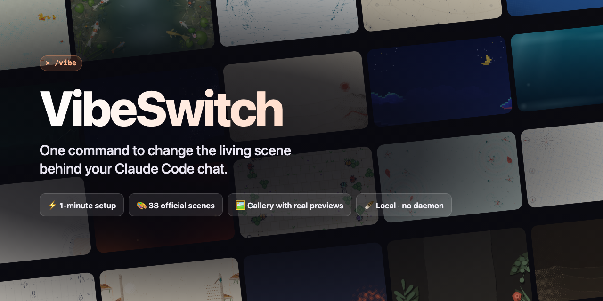
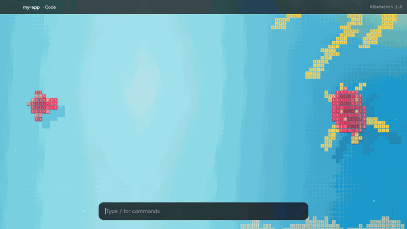
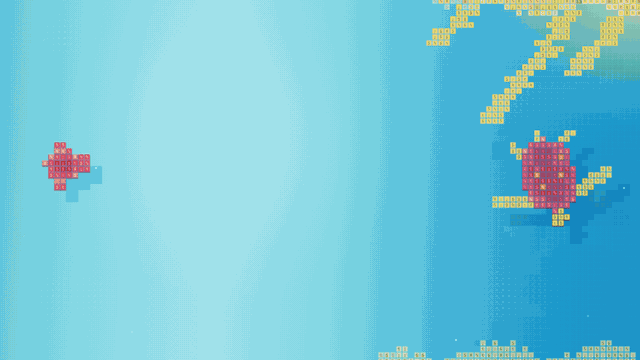
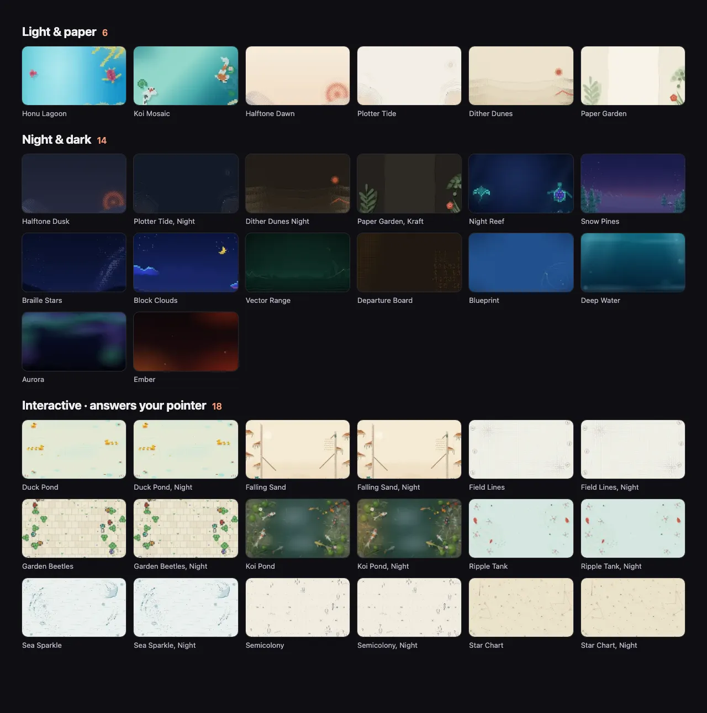

<p align="center">
  
</p>

<p align="center">
  <b>输入 <code>/vibe</code>，你的 Claude Code 窗口就换上一幅会动的新场景。</b><br>
  38 款 Anthropic 官方动态场景 · 带真实预览的画廊 · 全局 / 项目 / 会话三级选择 · 纯本地
</p>

<p align="center"><a href="README.md">English</a> · <a href="AGENTS.md">给 AI Agent 的安装指南</a> · <a href="https://buildwithclaude.com/themes">更多主题</a></p>

<p align="center"><br><sub>12 秒演示 · <a href="https://ruihaomei.github.io/vibeswitch/#demo">带音效观看</a></sub></p>

---

## ⚡ 大约一分钟装好

**最省事：交给你的 Agent。** 把下面这句话粘贴给 Claude Code（或你 Mac 上任意编程 Agent）：

```text
请按照 https://github.com/ruihaomei/vibeswitch/blob/main/AGENTS.md 为我安装 Claude Code 插件 VibeSwitch，装好后告诉我怎么开始用。
```

**或者自己跑两条命令：**

```bash
claude plugin install theme-examples --marketplace anthropics/claude-plugins-official
```

```bash
claude plugin install vibeswitch --marketplace ruihaomei/vibeswitch
```

第一条安装 Anthropic 官方场景，第二条安装 VibeSwitch。提示添加 marketplace 时输入 `y`。

**然后：**

1. 打开 **Claude 桌面版 → Code 标签页**，**新建一个会话**。
2. 输入 **`/vibe`**，选一个编号。完成。

<p align="center"></p>

## 为什么用 VibeSwitch

| | |
|---|---|
| 🎯 **一条命令** | `/vibe` 列出所有场景；`/vibe 11` 或 `/vibe night reef` 直接切换。 |
| 🖼 **先看再选** | `/vibe preview` 打开画廊面板：每个场景的真实画面，一键 **预览 / 设为默认 / 设为项目**。 |
| 🗂 **各得其所** | 全局默认、每个项目一个、临时只在本会话。会话 > 项目 > 默认。 |
| 🪶 **轻量** | 普通插件：无后台进程、无服务器、不联网。只有一个看得懂的配置文件。 |
| 🤝 **不打架** | 从不修改其他插件；同一时间只显示一个场景，背景不会叠在一起。 |

## 常用命令

| 命令 | 效果 |
|---|---|
| `/vibe` | 按氛围分组的编号列表 |
| `/vibe <编号或名字>` | 本会话使用 |
| `/vibe preview` | 打开带预览和按钮的画廊 |
| `/vibe default <主题>` | 以后所有会话都用它 |
| `/vibe project <主题>` | 在这个项目里都用它 |
| `/vibe session inherit` · `project inherit` | 撤销对应层的选择 |
| `/vibe off` | 本会话恢复原始外观 |
| `/vibe status` | 现在显示什么、为什么 |
| `/vibe refresh` | 重新识别主题插件并重建预览 |

<p align="center"></p>

## 想要更多主题？

去 **[buildwithclaude.com/themes](https://buildwithclaude.com/themes)** 挑选社区主题。下面三款 VibeSwitch 已内置支持，装好后会自动出现在 `/vibe` 和画廊里（装完运行 `/vibe refresh`）：

| 主题 | 安装 |
|---|---|
| [Rainy Window](https://github.com/ishuagrawal/claude-code-themes) 雨天小屋，跟随明暗模式 | `claude plugin install rainy-window --marketplace ishuagrawal/claude-code-themes` |
| [Garden](https://github.com/cktang88/claude-garden-theme) 米色纸张与实时仪表 | `claude plugin install garden-theme --marketplace cktang88/claude-garden-theme` |
| [Backdrops](https://github.com/neverblinks/backdrops) 九款电影感黄昏与夜景 | `claude plugin install backdrops --marketplace neverblinks/backdrops` |

## 常见问题

- **输入 `/vibe` 没变化？** 场景由 Claude 桌面版的 Code 标签页绘制。安装后请**新建会话**再试。
- **会拖慢电脑或联网吗？** 不会。只在会话开始或你用 `/vibe` 时运行，不联网。
- **怎么卸载？** `claude plugin uninstall vibeswitch`，再删掉 `~/.config/vibeswitch` 和 `~/.cache/vibeswitch`。

## 致谢

场景与画面来自 Anthropic 的 [theme-examples](https://github.com/anthropics/claude-plugins-official/tree/main/plugins/theme-examples) 插件（Apache-2.0），本仓库的预览图为其单帧缩略图，详见 [NOTICE](NOTICE)。VibeSwitch 代码以 MIT 协议开源。

<p align="center"><b>如果 VibeSwitch 让你的工作台更好看了一点，点个 ⭐ 能帮更多人发现它。</b></p>
